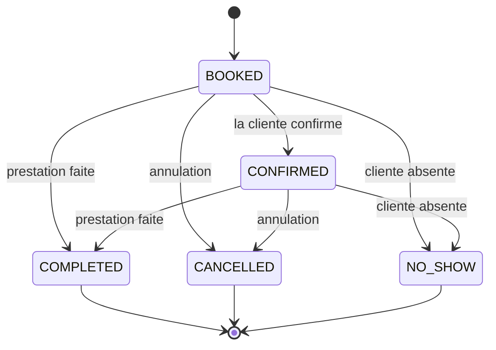

# États d'un rendez-vous

COMPLETED, CANCELLED et NO_SHOW sont des états finaux : une fois atteints, aucun autre statut n'est possible. Les chiffres du dashboard (chiffre d'affaires, taux de no-show) et la cible du modèle de no-show reposent sur ces statuts : s'ils pouvaient changer après coup, les KPI d'hier changeraient aujourd'hui.

Conséquence pour G3 : l'action "marquer no-show" est refusée sur un rendez-vous CANCELLED, et aussi sur un rendez-vous dont l'heure n'est pas encore passée. Cette dernière règle ne se voit pas dans le diagramme : elle est vérifiée par l'API.
