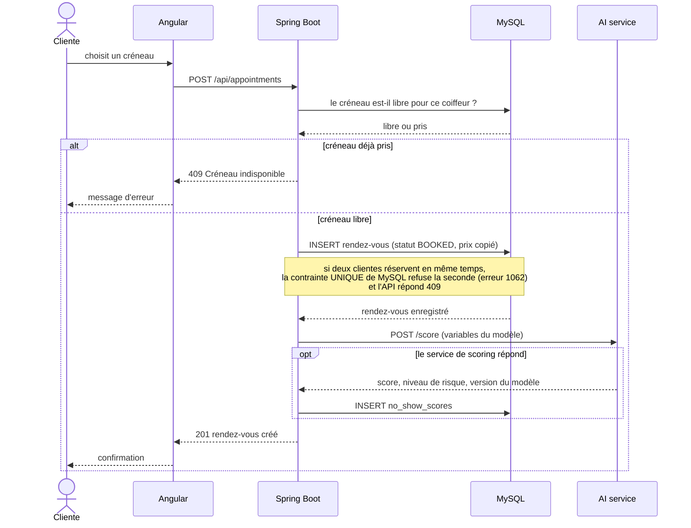

# Séquence : réserver un créneau

Parcours d'une cliente qui réserve. Il couvre les critères C3 (créneau pris, réservation réussie) et S1 (la réservation survit à une panne du scoring).

Si l'AI service est en panne, le bloc `opt` est sauté : la réservation est quand même confirmée et le score est calculé plus tard.
