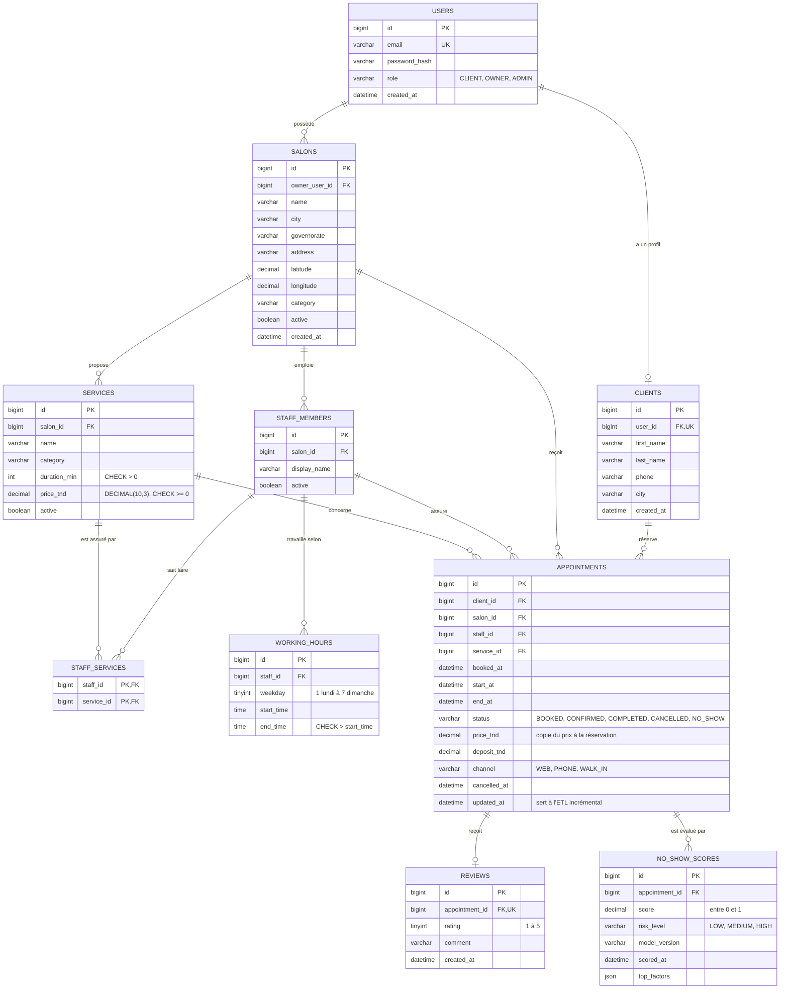

# Modèle de données (base transactionnelle MySQL)

Dix tables. Les montants sont en `DECIMAL(10,3)` (ADR 0002), les dates en heure locale de Tunis (ADR 0001), et on désactive au lieu de supprimer (ADR 0003).

## Lecture des cardinalités

- `||--o{` : un à plusieurs. Un salon emploie zéro ou plusieurs coiffeurs ; un coiffeur appartient à un seul salon.
- `||--o|` : un à zéro-ou-un. Un compte a au plus un profil cliente ; un rendez-vous reçoit au plus un avis (clé unique sur `appointment_id`).
- `STAFF_SERVICES` est une table de jointure : elle transforme la relation plusieurs-à-plusieurs entre coiffeurs et services en deux relations un-à-plusieurs. Sa clé primaire est composée des deux clés étrangères.
- `NO_SHOW_SCORES` n'a pas de clé unique sur `appointment_id` : un rendez-vous peut être scoré plusieurs fois (nouvelle version du modèle, recalcul).

## Choix à retenir

- `appointments.salon_id` est redondant avec `staff_id` (un coiffeur appartient à un salon), mais il évite une jointure dans les requêtes de l'agenda et du dashboard.
- La colonne générée `blocking_start` (étape 2.5) n'apparaît pas ici : elle sert de garde-fou en base et ne fait pas partie du modèle métier.
